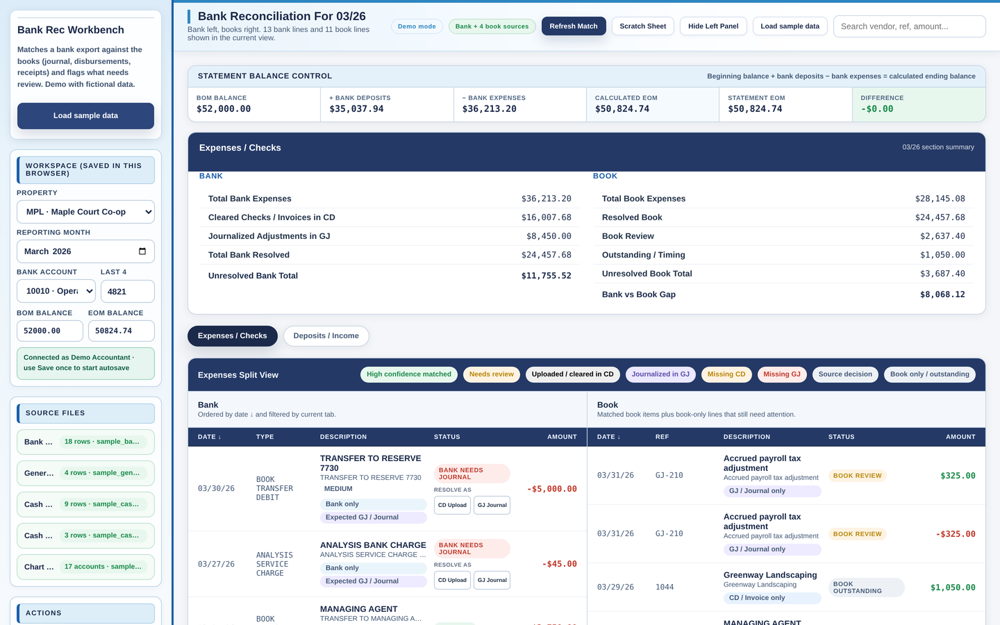
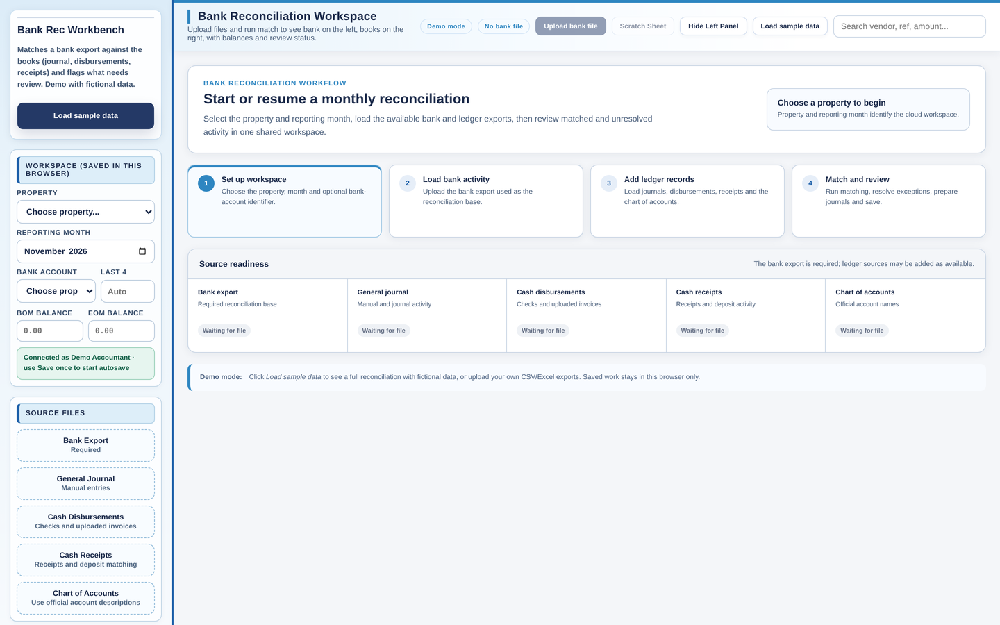
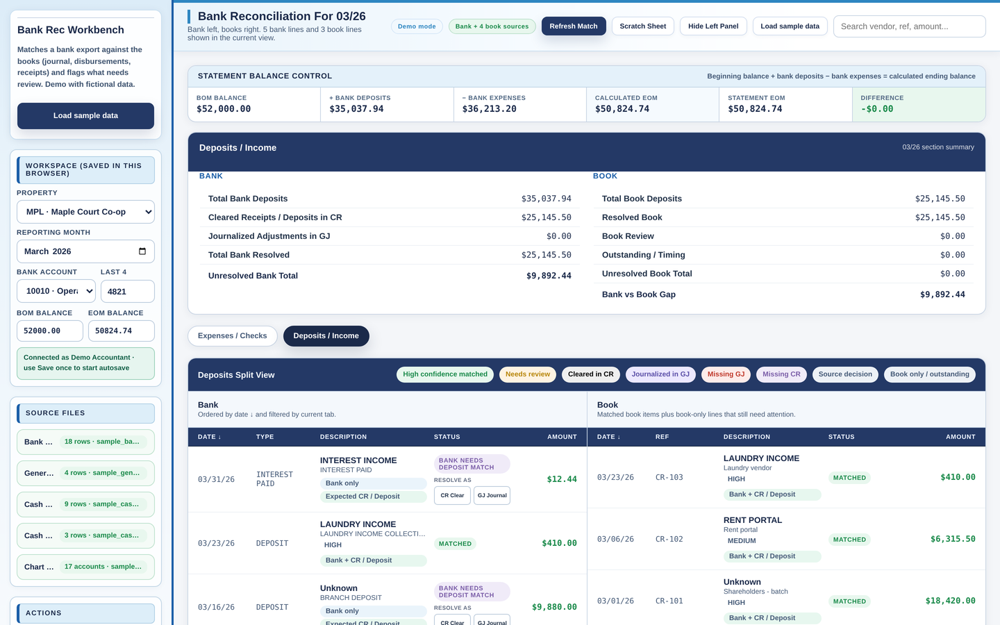
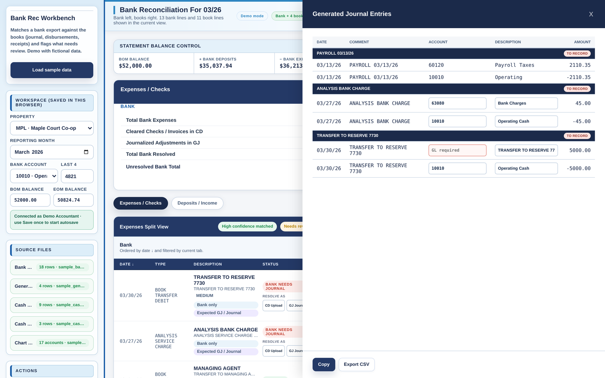

# Bank Rec Workbench

A browser-based bank reconciliation tool that matches a bank export against the books (general journal, cash disbursements, cash receipts) and sorts every line into *matched*, *needs review*, or *missing entry*, then drafts the journal entries needed to close the gaps.

**[Live demo →](https://porokmi.github.io/bank-reconciliation-engine/)** — click **Load sample data** to run a full reconciliation on fictional data.

---

## Why I built this

Reconciling bank accounts every month was one of the slowest, most manual parts of my job: matching each bank line by hand against the general journal, cash disbursements and cash receipts, and chasing the ones that didn't line up. I built this tool on my own initiative to automate that work. It now handles the routine matches, flags what needs a person's judgment, and drafts the journal entries for anything missing. It has cut the time I spend on reconciliations roughly in half and made my workload lighter. I'm its main user, and some of my colleagues use it too; for all of us the process is faster and smoother.

## How this was built: AI disclosure

I built this with substantial help from AI, mostly OpenAI Codex, with some help from Anthropic's Claude. To be clear about who did what:

- **My part:** I defined the problem from my own reconciliation work and decided how matching should behave (check numbers and split checks, vendor name aliases, date windows, payroll and transfers). I tested it, and I decided what to keep or change.
- **AI's part:** AI wrote most of the code (the HTML, CSS and JavaScript, the file import and the matching engine) from my descriptions, and helped me debug it.
- **Checking:** before relying on it, I compared its results with reconciliations I had done by hand.
- **This public version:** turning it into a demo (browser-only storage, fictional sample data) and setting up this repository were also done with AI help, including Claude Code.

## How the matching works

Each bank line is routed through a sequence of rules, from most to least certain:

| Step | What it checks | Example |
|---|---|---|
| **Checks** | Check number on the bank line vs. the disbursement register. Split checks (one check, several invoice lines) are grouped and summed first. | Check #1042 = $500.00 + $360.50 |
| **Vendor rules** | A keyword table maps messy bank descriptions to a canonical vendor, its book source and its GL account. | `CON ED CECONY BILLPAY 8812` → Con Edison → 60420 Electricity |
| **Amount + date window + text** | Same amount (±$0.02), within a vendor-specific day window, and a vendor alias or shared word in the book description. Candidates are scored by days apart; alias hits rank ahead of fuzzy text hits. | Mortgage payments allow 20 days; deposits 4–7 days |
| **Amount + date only** | If the text doesn't agree but amount and timing do, the pair is shown as a *balance match* for a person to confirm. | `NATIONAL GRID` vs. book vendor `Natl Grid Gas` |
| **Payroll and transfers** | Payroll is split into wages, taxes and fees and matched to journal entries; transfers are checked against management-fee invoices before being flagged. | `ADP TAX` with no journal entry → *Missing GJ* |

Anything left over becomes an exception: **Missing GJ** (bank activity with no journal entry), **Missing CD/CR** (no disbursement or receipt), or **Book only** (recorded in the books but not yet cleared, e.g. outstanding checks). For Missing GJ items, the tool drafts a balanced journal entry with the GL account filled in where a rule exists.

A balance-control panel checks that *beginning balance + deposits − withdrawals = statement ending balance* and shows any remaining difference; completing a reconciliation with an open difference triggers a warning.

## NYC building compliance (production version only)

The production version also tracks NYC compliance for the co-op and condo buildings we manage, and lets us research a building before we take it on. Two Supabase Edge Functions, also built with AI help, do this:

- **Address verification:** matches each property address to its official BBL (tax lot) and BIN (building ID) through NYC GeoSearch and the Property Address Directory.
- **Compliance refresh:** for each verified building, pulls public records from 34 NYC Open Data datasets (DOB violations, permits, boilers, elevators and façades; HPD violations, complaints and registration; FDNY, DEP, DSNY, DOT, Landmarks, NYC Health water tanks, OATH hearings, and LL33/LL84 energy data), saves a snapshot, and raises alerts when a violation is issued, a status changes, or a balance changes.

That code is not part of this repository and does not run in the demo. It's available to discuss on request.

## Running it

It's a single HTML file with no build step.

- **Online:** open the live demo link above.
- **Locally:** download `index.html` and open it in a browser.
- **Your own files:** upload CSV or Excel exports in the left panel. Column names are detected automatically (date, amount, vendor, reference, description). The files in [`sample-data/`](sample-data) show the expected shape.

## About this demo version

The production version ran on a hosted Postgres database (Supabase) with sign-in, role-based access (accountant-only), shared saved reconciliations across a team, and property-specific matching rules stored in the database. For this public version:

- The database client is replaced by a small in-browser stand-in with the same interface, so saving, reopening and switching reconciliations still work, but **all data stays in your browser**.
- All properties, vendors, lenders, account numbers and amounts in the sample data are **fictional**.
- Client-specific matching rules were removed or replaced with generic examples.

## Tech

JavaScript · HTML/CSS · SheetJS (Excel parsing) · PostgreSQL / Supabase and Supabase Edge Functions (TypeScript, Deno) in the production version · NYC Open Data (Socrata API) and NYC GeoSearch · Cloudflare Pages (production hosting) · Built with OpenAI Codex and Anthropic Claude

## Screenshots

| Start screen | Deposits and missing receipts | Drafted journal entries |
|---|---|---|
|  |  |  |
